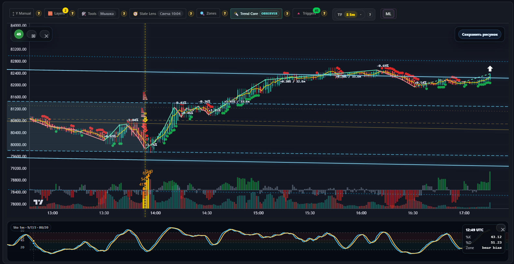

# Биржевые инструменты

<figure><figcaption>Цена, объём и рабочая разметка — в одном представлении.</figcaption></figure>

Событие на графике должно вести к объяснению: что обнаружено, на каких данных,
какой проверкой подтверждено и что ещё требует решения человека.

В собственном аналитическом проекте я развиваю интерфейс такого разбора.
График связан с карточкой события, исходными данными, результатами расчёта
и отметками проверки. Автоматически найденный кандидат и принятый результат
показываются раздельно.

## Как работает разбор

1. Выбрать событие и нужный временной срез.
2. Открыть карточку с объяснением и расчётом.
3. Сопоставить автоматический вывод с исходными данными.
4. Зафиксировать решение или оставить случай на проверке.
5. Вернуться к результату вместе с его условиями и версией.

## Развитие: исследовательский цикл

Данные → версия метода → обучение → проверка на следующем временном периоде
→ исполнение → сравнение и вывод.

Журнал сохраняет условия опыта и результаты сравнения. Это помогает отличать
правильно выполненный расчёт от полезного улучшения. Отрицательный результат
тоже сохраняется: он исключает уже проверенную гипотезу.

## Что показывает этот пример

- Связь визуализации, расчётов и ручной проверки.
- Разделение исходных данных, кандидатов и подтверждённых решений.
- Версионирование исследовательского опыта и объяснимое сравнение.
- Понятный переход от общего отчёта к отдельному событию.

[Вернуться к портфолио](../index.html#examples)
