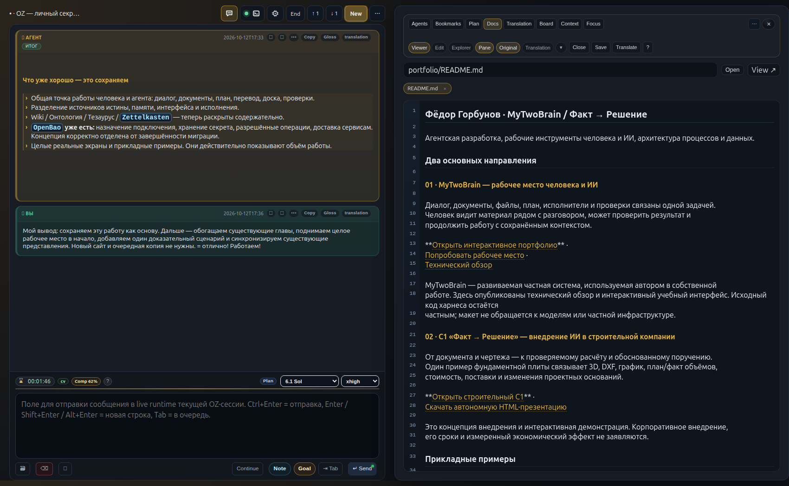
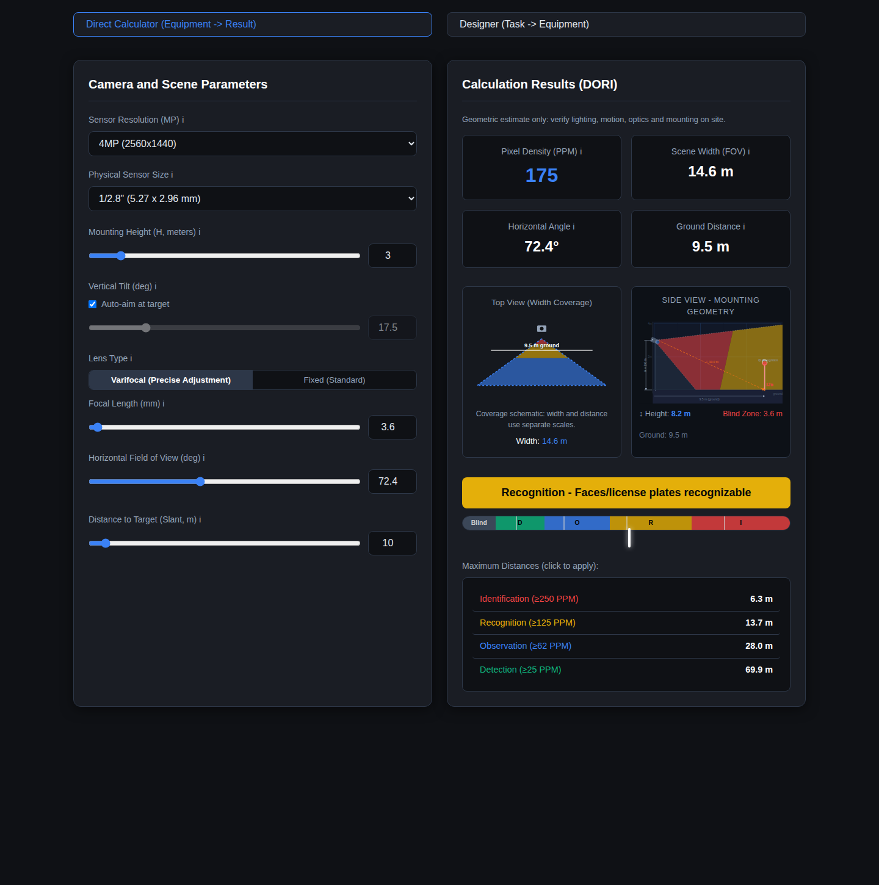
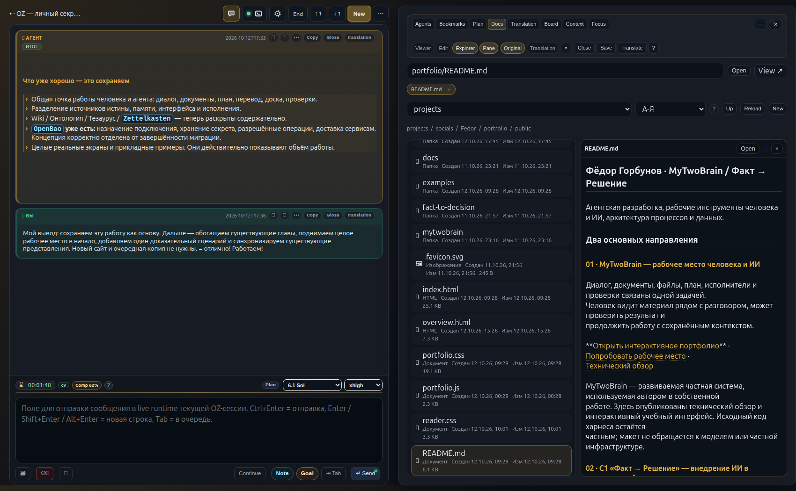
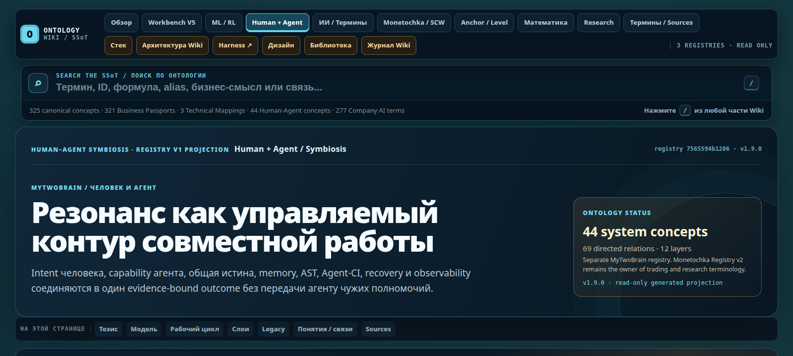
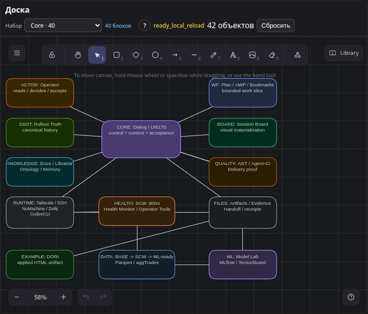

# MyTwoBrain / UI5175: карта агентной инженерной системы

**Диалог, документы, агенты и проверка результата — в одном рабочем контексте.**

Собственный проект Фёдора Горбунова · обновлено 12 октября 2026.

<nav class="map-nav" id="readme-navigation" aria-label="Разделы MyTwoBrain">
<a href="#workspace">Рабочее место</a>
<a href="#2-карта-систем">Связи</a>
<a href="#orchestration">Агенты</a>
<a href="#knowledge-memory">Знания</a>
<a href="#connections-security">Безопасность</a>
<a href="#dori-case">Результат</a>
<a href="#cooperation">Сотрудничество</a>
</nav>

## Общее рабочее место человека и агентов {#workspace}

<figure class="workplace-figure"><figcaption>Действующий интерфейс, 12 октября 2026. Для показа выбран нейтральный фрагмент нашей работы над портфолио; внутренние идентификаторы сокращены в браузерном представлении. Нажмите, чтобы рассмотреть весь экран.</figcaption></figure>

MyTwoBrain — среда для агентной разработки и ведения длительных задач.
Человек задаёт цель и принимает результат; агенты работают с документами,
кодом и инструментами в тех же границах задачи.

Harness — обвязка этой работы: история, контекст, роли, инструменты,
проверки и продолжение после перерыва. Её операторский интерфейс — UI5175.
Возможности и этапы развития указаны отдельно.

<div class="workplace-points">
<p><strong>Слева — разговор и управление.</strong> Цель, история, ввод поручения, модель и глубина рассуждения остаются рядом.</p>
<p><strong>Справа — предмет работы.</strong> Документ, Explorer с предпросмотром, план, перевод или доска открываются в том же рабочем месте.</p>
<p><strong>Один объект — два способа проверки.</strong> Человек видит данные в UI, агент читает их через API, CLI и исходные файлы. Версия и результат должны совпадать.</p>
</div>

[Попробовать интерактивную экскурсию](workspace.html) ·
[Открыть DORI](../examples/dori.html) ·
[C1 «Факт → Решение»: применение в строительстве](../fact-to-decision/index.html)

В экскурсии можно переключить документ и вкладки, выбрать модель,
проверить учебный результат и увидеть, как изменение основания отменяет
прежнюю проверку. Макет объясняет взаимодействие; реальный интерфейс показан выше.

## Цель

Показать собственную операторскую среду для управляемой агентной разработки и
провести по её рабочему маршруту: от цели и обследования процесса до проверяемого
артефакта, наблюдаемого runtime и передачи результата.

Пакет показывает не набор отдельных технологий, а целую инженерную среду:
удалённый сервер, CodexCLI/OZ, UI5175, память, документацию, агентские
процедуры, проверку результата, observability и ML/data-контур.

MyTwoBrain/UI5175 - собственная рабочая среда, в которой человек принимает
решения, подтверждает результат и выполняет внешние действия.


Материал подходит для технического разговора о рабочей среде,
агентной разработке и адаптации этих подходов под задачи команды.

<p class="section-home-row"><a class="section-home" href="#readme-navigation" aria-label="Наверх к навигации" title="Наверх к навигации">⌂</a></p>

## 1. Короткая формула

1. **Поставить задачу:** цель человека, применимый контекст и ограниченный участок работы.
2. **Выполнить:** агентное действие и открываемый артефакт.
3. **Проверить:** AST, тесты, Agent-CI, наблюдаемость и доказательства.
4. **Принять и продолжить:** решение человека, передача результата, опыт и следующий шаг.

У работы есть понятная цель, ответственный, применимые источники и критерии
приёмки. После исполнения остаются открываемый результат и сведения о том,
что именно проверено. Человек может продолжить работу или передать её другому исполнителю.

<p class="section-home-row"><a class="section-home" href="#readme-navigation" aria-label="Наверх к навигации" title="Наверх к навигации">⌂</a></p>

## 2. Карта систем

### 2.1 Верхний уровень

```projection
projection "Одно рабочее место — связанные возможности"
node human fact "Человек" "Цель, ограничения и решение о приёмке"
node workplace derived "Общий UI / API" "Диалог, сессии, терминал, предпросмотр, перевод, доска и Architecture Focus"
node agents annotation "Агенты и исполнение" "Профили, группы, оркестратор, mailbox, watchdog; skills, AWP, план и закладки"
node knowledge fact "Контекст и знания" "Wiki, онтология, тезаурус, документы, Librarian, память и AST"
node proof gate "Проверка результата" "Тесты, Agent-CI, Delivery Proof; журналы, метрики и traces"
node result annotation "Инженерный результат" "Код, документы, данные и receipts; приложения ML/data и Model Lab"
edge human -> workplace "цель"
edge workplace -> agents "роли"
edge workplace -> knowledge "поиск"
edge workplace -> proof "тесты"
edge agents -> result "артефакт"
edge knowledge -> result "основания"
edge proof -> result "проверки"
```

Наведите на узел или стрелку, чтобы проследить ближайшие связи. С клавиатуры
используйте Tab; Escape снимает выделение. Карта показывает связи возможностей,
а не последовательность сетевых вызовов. Размещение и назначение систем — ниже.

**Основа исполнения:** Tailscale, SSH / NoMachine и Ubuntu Server98;
systemd, Docker, Zellij и CodexCLI. AST связывает результат со структурой кода,
а память сохраняет проверенный опыт для следующей задачи.

### 2.2 Системы, назначение и владелец результата

| Слой | Система | Назначение | Результат |
| --- | --- | --- | --- |
| Доступ | Ubuntu Server98 | Основной host для проекта, сервисов и документов | Рабочая среда, на которой живут runtime и SSoT файлов |
| Доступ | Tailscale | Частный overlay-доступ между рабочими устройствами и сервером | Достижимость сервера без публичного port forwarding |
| Доступ | SSH / NoMachine | Текстовый и графический operator access | Подключение, диагностика и визуальная работа с сервером |
| Host lifecycle | systemd / Docker | Владение долгоживущими сервисами, контейнерами и restart policy | Управляемый runtime вместо ручного запуска в терминале |
| Execution | Zellij | Persistent terminal workspace для агентной сессии | Сессия переживает разрыв браузера и attach-соединения |
| Execution | CodexCLI | Фактический цикл reasoning, tool use, editing и verification | Rollout и изменения в рабочем дереве |
| Session control | OZ | Обвязка CodexCLI: запуск, resume, metadata, logs и lifecycle | Связанная OZ-сессия с plan, notes, bookmarks и evidence |
| Operator surface | UI5175 | Общая точка наблюдения и контролируемого управления | Оператор видит одну текущую картину и допустимые действия |
| Dialog | `session_view.html?kind=dialog` | Работа с одной сессией, её историей и текущей задачей | Диалог, AWP, план, статусы, next action и handoff |
| Runtime observer | Terminal V2 | Лёгкий screen observer поверх Zellij | Снимок живого терминала и честное состояние runtime |
| Docs surface | Docs Explorer / Workbench | Навигация по документам и артефактам с предпросмотром | Связанный документ, изображение, PDF или HTML-артефакт |
| Collaboration | Session Board | Быстрый совместный набросок схемы рядом с диалогом | Session-scoped карта и сохранённые варианты |
| Architecture | Architecture Focus / C4 | Фокус на текущем AppDescriptor-контуре и его связях | Read-only архитектурный маршрут и runtime overlay |
| Knowledge | Docs / Librarian / DOC Graph | Поиск канонического документа, связей и provenance | Ссылка на owner-документ, а не копия смысла |
| Memory | Zettelkasten / GoalMemory / situation | Кандидаты опыта и временная сборка применимого контекста | Reviewable memory artifacts с source refs и применимостью |
| Semantics | Ontology Wiki | Словарь понятий, отношений и границ ответственности | Семантический маршрут к owning document или registry |
| Connections | OpenBao / права операций / доставка сервисам | Хранение секретов отдельно от назначения подключения и правил использования | Разрешённая операция и её результат без раскрытия ключа в диалоге |
| Code intelligence | AST / symbol passports | Навигация по структуре кода и impact frontier | Symbols, imports, owners и затронутые области |
| Procedure | Skills / hooks / composition graph | SOP для повторяемых операций и соседних проверок | Bounded route и execution receipt |
| Coordination | Реестр / группы / оркестратор | Состав команды, назначение работ и проверка общего итога | У каждой части и результата есть ответственный |
| Delivery | Mailbox / watchdog | Адресная передача результата и уведомление владельца | Видно, что сохранено, доставлено, прочитано и принято |
| Quality | Agent-CI / Delivery Proof | Проверка зафиксированных границ, AST, тестов, сборки и evidence | Owner-bound verdict, repair chain и текущая proof-свежесть |
| Observability | Prometheus / Loki / Tempo / Grafana | Метрики, логи, traces и runtime diagnosis | Correlated evidence вместо одного зелёного индикатора |
| Data / ML | SCW / Monetochka / FLAPPING_WINGS_AI | Потоковые данные, ML-ready подготовка и Model Lab | Проверенный dataset, состояние контура, model run и operator view |

### 2.3 Границы авторства

Главная инженерная дисциплина системы - не смешивать интерфейс, память и
источник истины.

- Codex rollout JSONL хранит каноническую историю диалога.
- `dialog.log`, history, UI и summary являются производными представлениями.
- `plan.json` хранит session-wide план; Active Work Package (AWP) описывает
  текущий ограниченный work slice.
- Source files, tests, contracts, authored docs, registries и runtime владеют
  своими смыслами.
- AST служит навигацией и evidence impact, но не заменяет исходники и тесты.
- UI5175 связывает слои и показывает их оператору, но не становится вторым SSoT.
- Graph, vector index, SQLite, JSONL и UI-проекции ускоряют чтение, но не
  получают права самостоятельно менять значение сущностей.

<p class="section-home-row"><a class="section-home" href="#readme-navigation" aria-label="Наверх к навигации" title="Наверх к навигации">⌂</a></p>

## 3. Технологический и инженерный слой

### 3.1 Infrastructure и runtime

- Linux Ubuntu Server98 как постоянный host.
- Tailscale для приватного удалённого доступа; SSH и NoMachine для разных
  рабочих сценариев.
- `systemd` владеет сервисным lifecycle; Docker используется для изолированных
  runtime и лабораторных контуров.
- Zellij удерживает живую терминальную сессию независимо от браузера и
  временного сетевого подключения.
- UI5175 работает как HTTP operator/control plane, а терминал остаётся отдельной
  поверхностью.

### 3.2 Application и automation stack

- Codex CLI как основной цикл исполнения: чтение контекста, инструменты,
  изменения и проверка. Версия установленного CLI меняется отдельно от концепции Harness.
- Python для backend, automation, validators, data pipelines и operational
  probes.
- TypeScript/JavaScript и React/Vite-поверхности для UI5175 и связанных
  операторских экранов.
- Git, content hashes, JSON/JSONL, SQLite и filesystem-first artifacts для
  истории, индексов, receipts и восстановимых материалов.
- MCP применяется там, где нужен stateful/shared runtime; CLI и skill подходят
  для короткого воспроизводимого пути с низкой стоимостью контекста.

### 3.3 Инженерные контракты

Для каждого существенного изменения задаются:

1. `goal` и `non_goals`;
2. факты, зависимости и owned paths;
3. acceptance criteria;
4. evidence plan и stop conditions;
5. результат, receipt и handoff.

Это превращает «попросить агента что-то сделать» в управляемый процесс. При
изменении upstream-артефакта старый downstream gate становится `stale`, а не
остаётся ложным green. Повторяется только затронутая ветка.

### 3.4 Доказательная инженерия

| Шаг | Что связывает результат с исходной задачей |
| --- | --- |
| Постановка и маршрут | Версия AWP, квитанция выбора маршрута и квитанции этапов |
| Артефакт | Точная версия полученного материала |
| Проверка | AST, тесты, Agent-CI и итоговый gate |
| Наблюдение | UI / API / CLI показывают тот же проверенный объект |

Receipt фиксирует наблюдаемые факты:

- идентичность candidate и границы работы;
- revision input/output;
- skill и policy revision;
- ссылки на evidence;
- outcome: `executed`, `no_change`, `skipped`, `failed`, `blocked`;
- свежесть итоговой проверки.

Проверка относится к определённым файлам и версии результата. При изменении
основания она теряет актуальность. Успешный тест, Agent-CI, публикация,
работающий интерфейс и приёмка человеком подтверждают разные этапы работы.
Их связь можно проследить на [выполненном примере DORI](#dori-case).

<p class="section-home-row"><a class="section-home" href="#readme-navigation" aria-label="Наверх к навигации" title="Наверх к навигации">⌂</a></p>

### 3.5 Подключения и безопасность действий {#connections-security}

**Человек подключает сервис один раз. Агенты и приложения используют его
по назначению, в пределах выданных прав.**

Слой связывает имя подключения с его назначением, разрешёнными действиями
и потребителями. Для хранения секретов выбран OpenBao. Приведённая схема
описывает устройство продукта; перенос существующих подключений идёт поэтапно.

```projection
projection "1 · Человек подключает сервис"
node human fact "Человек" "Называет подключение, задаёт назначение и вводит секрет"
node vault annotation "OpenBao" "Хранит значение, версии и правила доступа к секрету"
node card fact "Карточка подключения" "Имя, назначение, владелец, права, потребители; ссылка на секрет без значения"
node observer derived "Общий UI / API" "Имя подключения, заполненность, проверки и версии; без раскрытия значения"
edge human -> vault "секрет"
edge human -> card "назначение"
edge vault -> observer "версия"
edge card -> observer "каталог"
```

```projection
projection "2 · Агент использует разрешённую операцию"
node agent derived "Агент" "Знает имя подключения и доступные операции; самого секрета не получает"
node policy gate "Проверка полномочий" "Назначение и права из карточки; проверка действия, ресурса и потребителя"
node vault annotation "OpenBao" "Доступ по выданным правам; credential только доверенному исполнению"
node service annotation "Шлюз / доверенный сервис" "Исполняет разрешённое действие с credential; секрет остаётся внутри доверенного исполнения"
node result derived "Результат агенту" "Данные или отказ, без выдачи credential в контекст модели"
node observer derived "Общий UI / API" "Список, заполненность, проверки, версии, ошибки и журнал операций"
edge agent -> policy "операция"
edge policy -> vault "права сервиса"
edge vault -> service "credential"
edge service -> result "ответ"
edge service -> observer "состояние"
```

Стрелки показывают модель доступа. Секрет поступает в доверенное исполнение;
агенту возвращается результат операции. Подписи и цвет различают источник,
обработку и проверку полномочий. Это архитектурная модель, не отчёт о завершении миграции.

#### Что хранится и кто использует

| Часть слоя | Назначение |
| --- | --- |
| Карточка подключения | Имя, бизнес-назначение, владелец, разрешённые действия и потребители. Содержит ссылку на секрет, без его значения. |
| OpenBao | Защищённое хранение значений, их версий и управление доступом к ним. Человек вводит или заменяет секрет через операторский интерфейс. |
| Политика доступа | Определяет, кто вправе выполнить конкретное действие над указанным ресурсом. Знание имени подключения не даёт прав. |
| Шлюз операций | Проверяет доступ, использует нужный секрет и возвращает агенту результат разрешённого вызова. |
| Доставка сервисам | Передаёт приложению только необходимые ему поля через согласованный адаптер, файл credentials или runtime-переменные. |
| Общая точка наблюдения | Показывает людям и агентам доступные метаданные одного подключения: назначение, проверки, версии и состояние потребителей. |

Systemd и Docker запускают потребителей с выделенным для них доступом.
Способ доставки зависит от приложения; общий набор секретов всем процессам
не раздаётся. Доверенный сервис может прочитать собственные реквизиты — они
нужны ему для работы. Агентному интерфейсу доступны результаты и разрешённые
метаданные, без выдачи значений ключей.

#### Работа без постоянных ручных согласований

Обычные действия внутри выданных прав выполняются без подтверждения каждого
вызова. Новое назначение или расширение полномочий требует отдельного решения.
Лимиты внешнего сервиса и ожидание свободного ресурса отображаются с причиной.

Проверки отвечают на разные вопросы: заполнено ли подключение, подходит ли
учётная запись, достаточно ли прав, выполнилась ли нужная операция.
После замены секрета проверяется загрузка новой версии каждым потребителем.
Отзыв доступа и восстановление также входят в жизненный цикл подключения.

**Граница доверия.** Отсутствие ключа в контексте агента не отменяет контроль
его действий и получаемых данных. Хранилище на общем хосте не гарантирует
изоляцию от администратора с полными правами.

#### Какие данные получает модель

Ключ подключения и содержимое запроса — разные объекты защиты. Документ может
содержать персональные данные, переписку или внутренние сведения даже без API-ключа.
Для каждого внедрения определяются допустимые источники, состав передаваемого
контекста и разрешённый маршрут модели: внешний провайдер или локальный вывод.

Обезличивание, ограничения вывода и журналирование должны проверяться на
реальном пути операции. В этом разделе зафиксирован подход; полная изоляция
всех инструментов и материалов персонального окружения не заявляется.

<p class="section-home-row"><a class="section-home" href="#readme-navigation" aria-label="Наверх к навигации" title="Наверх к навигации">⌂</a></p>

## 4. Слой агентской разработки

Это основной фрагмент, который стоит показывать в техническом разговоре.

1. **Цель человека:** ограничения, бизнес-смысл и решение оператора.
2. **Сборка контекста:** действующие документы, онтология, применимый опыт,
   затронутый код и текущее состояние исполнения.
3. **Рабочий пакет:** цель, исключения, факты, пути, зависимости, критерии
   приёмки, план доказательств и условия остановки.
4. **Маршрут и исполнение:** skill, hook, CLI / MCP, CodexCLI,
   ограниченный помощник или ручное действие.
5. **Артефакт:** код, документ, данные, тест, схема или отчёт с точной версией.
6. **Техническая проверка:** AST impact, целевые тесты, browser / API E2E,
   Agent-CI, состояние исполнения и подтверждение доставки.
7. **Приёмка человеком:** сверка исходной цели, бизнес-результата, рисков и следующего шага.
8. **Передача и опыт:** воспроизводимый handoff, источники, история решений
   и принятие опыта в подходящий слой памяти.

<span id="41-как-устроена-память"></span>

### 4.1 Общие знания и память {#knowledge-memory}

**Понимать одинаково и продолжать с достигнутого.** MyTwoBrain связывает
разговор, принятые договорённости, документы и накопленный опыт.
Человек и агент могут найти основание ответа: откуда он появился,
где закреплён и применим ли к текущей задаче.

#### Общий язык и основания решений

| Компонент | Роль в работе |
| --- | --- |
| Wiki | Объясняет устройство системы и принятые способы работы. Помогает войти в тему без повторного пересказа проекта. |
| Онтология | Связывает устойчивые понятия, их отношения и владельцев. Ведёт к точному определению и действующему источнику. |
| Тезаурус | Сопоставляет названия, сокращения, русские и английские варианты с одним понятием. Помогает найти его разными словами. |
| Документы и договорённости | Фиксируют требования, решения и ограничения у ответственных за них владельцев. Дают основание для работы и проверки. |

У каждого понятия и договора — свой источник истины. Повторное отображение
в Wiki, графе или интерфейсе не создаёт вторую редактируемую копию правила.

#### История, опыт и навигация

Память - это не один «граф мозга» и не текущий контекст модели.
Каждый слой отвечает на свой вопрос:

| Слой | Вопрос | Статус |
| --- | --- | --- |
| Rollout history | Что фактически было сказано и сделано? | Source truth |
| Goal / plan / AWP | Что выполняется сейчас и в каких границах? | Workflow truth |
| Authored docs / ADR / Registry | Каково принятое значение и правило? | Semantic truth |
| DOC Graph / Librarian | Где связанный документ, owner и provenance? | Retrieval projection |
| Zettelkasten | Какие атомарные идеи и паттерны могут пригодиться? | Candidate projection |
| GoalMemory / situation | Что нужно собрать для текущего resume или handoff? | Query-time orientation |
| AST / symbol passports | Где структура и impact в коде? | Code navigation evidence |

Zettelkasten связывает отдельные наблюдения и идеи с источниками; это
кандидаты для дальнейшего применения. DOC Graph показывает связи документов,
а Librarian помогает найти действующего владельца и связанные материалы.
AST позволяет перейти к структуре кода и оценить затронутые части реализации.

#### Как опыт становится знанием

```projection
projection "Опыт становится знанием после проверки"
node observation fact "Наблюдение" "Работа, источник и обстоятельства; не готовое правило"
node review gate "Проверка" "Повторы, противоречия, применимость и решение предметного владельца"
node knowledge fact "Принятое знание" "Документ, ADR или Registry у своего владельца"
node use derived "Следующая задача" "Применение знания и новые наблюдения"
edge observation -> review "источник"
edge review -> knowledge "принятие"
edge knowledge -> use "применение"
edge use -> knowledge "уточнение" feedback
```

Перед принятием проверяются повторы, противоречия и применимость.
Идея может остаться гипотезой, быть отклонена или отложена; прежнее решение —
заменено новым. История сохраняет ход работы, а в действующие знания попадает
проверенный опыт. При повторном использовании проверяется его актуальность.

#### Один пример: доступ на чтение

> «Подключи агенту чтение данных, но запрети изменения».

1. **Найти понятие.** Тезаурус связывает слова «подключение», «доступ» и
   `connection` с нужной темой и её терминами.
2. **Понять границы.** Wiki и Онтология объясняют различие между секретом,
   подключением и разрешённым действием.
3. **Установить правило.** Документ подключения задаёт назначение,
   потребителя и допустимые операции. Связанный опыт помогает учесть прошлые ошибки.
4. **Выполнить действие.** Разрешённый инструмент использует подключение через
   [слой безопасности](#connections-security) и возвращает результат.
5. **Проверить вместе.** Человек в UI и агент через API сверяют результат
   одной операции над одним подключением; полезный опыт проходит проверку
   перед сохранением в знаниях.

Это пример связей между слоями, а не обязательный автоматический маршрут
для каждого запроса. Найденная заметка не выдаёт права доступа и не заменяет
действующий договор.

### 4.2 Агенты, группы и оркестратор {#orchestration}

Постоянный агент ведёт длительную работу и имеет профиль: назначение,
роль, связь с сессией и выбранный режим исполнения. Группа объединяет
участников вокруг задачи. Её состав и руководитель видны человеку.

Оркестратор удерживает общий результат: разбирает задачу, определяет
зависимости, распределяет независимые части, проверяет возвращённые материалы
и доводит работу до общего итога. Он также может выполнить часть работы сам.

<div class="agent-route" aria-label="Распределение и приёмка работы">
<a href="#workspace"><strong>Человек</strong><span>Цель и критерии</span></a><i aria-hidden="true">→</i>
<a href="#orchestration"><strong>Оркестратор</strong><span>План и зависимости</span></a><i aria-hidden="true">→</i>
<a href="#tools-models"><strong>Исполнители</strong><span>Роли и инструменты</span></a><i aria-hidden="true">→</i>
<a href="#dori-case"><strong>Общий результат</strong><span>Проверка и приёмка</span></a>
</div>

Для ограниченных независимых проверок могут привлекаться временные помощники:

- `code_mapper` - ownership, entrypoints, invariants и impact;
- `docs_researcher` - канонические документы и version-sensitive behavior;
- `browser_debugger` - DOM, console, network и screenshot evidence;
- `reviewer` - advisory review frozen diff без права выдавать final PASS.

Временный помощник возвращает результат назначившему его агенту. Постоянная
роль, сессия, состав группы и конкретная задача сохраняют разные значения.
Членство в группе само по себе не подтверждает занятость или выполнение поручения.

#### Параллельная подготовка и общий итог

Независимые части можно готовить одновременно в отдельных рабочих копиях.
В общий сервис готовые изменения вносятся согласованно: проверяются текущая
версия, результат предыдущего участника и совместимость нового изменения.
После объединения проверяется общий пользовательский сценарий.

План может вести web-агент или CLI-оркестратор. При передаче сохраняются
задача, критерии, полномочия и незавершённые действия. Ручной пилот,
договорённость о ролях и автоматическое управление имеют отдельные проверки зрелости.

### 4.3 Передача результата и уведомления

Mailbox сохраняет адресный результат для другого участника. Watchdog
напоминает владельцу о необходимости прочитать его. Получение уведомления,
чтение сообщения, подтверждение получения и приёмка работы различаются.

| Этап | Что известно | Кто делает следующий шаг |
|---|---|---|
| Результат сохранён | Материал и адресат зафиксированы | Канал доставки уведомляет адресата |
| Адресат уведомлён | Сигнал передан | Адресат открывает свой mailbox |
| Результат прочитан | Получатель ознакомился | Получатель подтверждает получение и оценивает материал |
| Работа принята | Ответственный сверил критерии и доказательства | Оркестратор объединяет результат или задаёт следующий шаг |

Если адресат недоступен, остаются сообщение, причина ожидания и следующее
действие. Уведомление не запускает новую цель и не возобновляет задачу,
которую человек поставил на паузу.

### 4.4 Модели, профили и инструменты {#tools-models}

Роль отвечает за назначение агента. Модель и глубина рассуждения определяют
способ обработки задачи; права операций задаются отдельно. Настройки в
профиле, фактически запущенный процесс и доступность провайдера проверяются раздельно.

| Часть | Для чего нужна |
|---|---|
| Skills | Повторяемые процедуры: что прочитать, как выполнить действие и проверить результат |
| Plugins | Упаковка связанных инструкций и возможностей |
| API / CLI / MCP | Конкретные операции с документами, сервисами и инструментами |
| Контекст проекта | Действующие требования, термины, источники и ограничения задачи |
| Модель и reasoning | Выбор доступного вычислительного режима под сложность работы |
| Квоты и бюджет | Причина ограничения, доступный маршрут и решение о продолжении |

Codex CLI исполняет агентный цикл; CLIProxyAPI связывает его с выбранным
провайдером. Локальная модель требует совместимой интеграции и проверки
инструментальных вызовов. Одно название в списке не доказывает готовность маршрута.
Учёт расхода помогает выбирать режим; точный срок и стоимость произвольной
задачи заранее не гарантируются.

<p class="section-home-row"><a class="section-home" href="#readme-navigation" aria-label="Наверх к навигации" title="Наверх к навигации">⌂</a></p>

<span id="5-диалог-как-crm-подобный-engineering-workbench"></span>

## 5. Как человек работает с агентами

Диалог связывает задачу с историей, документами, исполнителями и проверкой.
Открытый справа материал можно обсуждать слева, сохраняя оба представления перед глазами.

| Функция | Как это реализовано в Диалоге | Практическая ценность |
| --- | --- | --- |
| Карточка записи | Session identity, owner, cwd/repository, runtime presence, текущая цель и статус | Быстро понятно, с каким кейсом работаем |
| История взаимодействия | Канонический rollout, dialog/history и curated notes | Не теряется решение и видно, откуда взялся вывод |
| Воронка статусов | Plan items, AWP state, `open / in_progress / completed`, `operator_needed`, `blocked`, `stale` | Видно, что сделано, что ждёт решения и где остановка обоснована |
| Следующее действие | Acceptance, evidence plan, bookmarks, next action и stop conditions | Сессия не превращается в бесконечный разговор |
| Прикреплённые материалы | Links to docs, source paths, artifacts, screenshots, receipts и tests | Контекст задачи связан с проверяемыми объектами |
| Activity trail | Последовательность prompts, решений оператора, route receipts, proof и handoff | Можно восстановить ход работы без пересказа по памяти |
| Контроль качества | AST/Agent-CI/Delivery Proof и текущая свежесть gate | Отделяется «агент сказал» от «кандидат проверен» |
| Статус исполнения | Runtime observer, Terminal V2, logs, metrics и traces | Видно, агент работает, ждёт ввода, завершился или недоступен |
| Работа с рисками | Operator-needed, fail-closed states, stale proof, reason/action и recovery boundary | Не маскируется неопределённость и не происходит скрытое продолжение |
| Завершение кейса | Handoff package, receipts, accepted artifact и promotion decision | Результат можно передать человеку или следующей сессии |

Главное отличие от обычного чата: Диалог - это не одна лента сообщений, а точка
связывания `intent -> context -> action -> evidence -> acceptance`.
При этом UI не переписывает историю и не становится владельцем документов,
памяти, CI или runtime.

### 5.1 Точки взаимодействия UI5175

| Точка | Что можно сделать | Что получает оператор |
| --- | --- | --- |
| Диалог | Поставить цель, собрать контекст, выбрать модель и уровень reasoning, запустить действие и принять результат | Управляемый путь от запроса до handoff без разрыва между разговором и работой |
| CLI-функции в UI | Использовать основные функции Codex/OZ из интерфейса, не переключаясь постоянно в терминал | Один операторский маршрут для запуска, продолжения, планирования и проверки |
| Terminal V2 | Наблюдать bound runtime, отправлять ввод в привязанный Zellij pane и при необходимости работать с tmux внутри терминального контура | Доступ к живой сессии и её screen snapshot с сохранением отдельного observer path |
| Закладки | Отмечать фрагмент диалога, добавлять заметку, прикреплять evidence и передавать ветку в чат или план | Локальная память по ходу работы, которая не теряется в длинной истории |
| Переводчик и Translation Explorer | Переводить ответ агента или документ, выбирать prompt/model, открывать сохранённые варианты и повторять перевод | Управляемый перевод с видимыми моделью, prompt и происхождением результата |
| Локальная терминология | Подхватывать доменные слова из диалогов и переводческих заметок, связывать их с glossary и semantic layer | Повторяемый словарь проекта вместо случайного перевода терминов |
| Docs Explorer | Открывать Markdown, PDF, JPG/PNG, HTML и другие артефакты; переходить от исходного документа к результату | Быстрый просмотр материалов, CV, отчётов, скриншотов и приложенных примеров |
| Session Board | Совместно рисовать карту, раскладывать связи и сохранять варианты рядом с текущим диалогом | Визуальная карта рабочей задачи без подмены канонической draw.io-доски |
| Architecture Focus | Открывать C4/LikeC4-фокус по AppDescriptor и видеть связи, source freshness и runtime health | Быстрый ответ на вопрос «где находится этот контур и что с ним происходит» |
| История и поиск | Искать по полной истории rollout отдельно от текущего терминала и переходить к найденному сообщению | Восстановление решений и фактов без ручного пролистывания сессии |
| Runtime state | Видеть состояния выключен, активен, работает, нужно вручную, ошибка и завершение; получать operator attention для HITL, ошибок и финала | Понятно, выполняется ли работа, требуется ли решение или результат уже готов |
| Документы, отчёты и QA | Формировать отчётные артефакты, проверять текст, подключать CAD/draw.io-контуры через соответствующие инструменты и навыки | Результат выходит в форме, которую можно открыть, проверить и передать дальше |
| Model/provider contour | Управлять моделью и reasoning через UI; текущий подписочный путь идёт через CLIProxyAPI, а в тот же контур можно подключить локальную модель | Возможность менять вычислительный маршрут без перестройки рабочего процесса |

Именно эта связка делает UI5175 рабочим cockpit: Диалог задаёт движение,
Терминал показывает живой runtime, Закладки удерживают локальные решения,
Explorer открывает артефакты, Board и Focus показывают структуру, а observer и
уведомления возвращают оператору состояние исполнения.

<p class="section-home-row"><a class="section-home" href="#readme-navigation" aria-label="Наверх к навигации" title="Наверх к навигации">⌂</a></p>

## 6. Observability для агентного runtime

Observability нужен не для декоративного dashboard, а чтобы различать:

- агент действительно выполняет задачу;
- процесс ожидает действия оператора;
- браузер потерял attach, но persistent runtime продолжает работу;
- runtime остановился;
- delivery или provider path недоступен;
- результат есть, но proof устарел.

Зафиксированный O1 canary включал:

- Prometheus для метрик;
- Alertmanager для lifecycle alert semantics;
- Loki для логов;
- Tempo для traces;
- Alloy для сбора;
- Grafana для глубокого telemetry view;
- UI5175 `/observe.html` как общий operator entry point.

Перечень отражает построенный наблюдательный контур и ранний проверочный
срез. Текущая доступность компонентов и внешняя доставка уведомлений читаются
у их владельцев. Снимок панели или прошлая успешная проверка не подтверждают
непрерывную работоспособность всех сервисов.

### Продолжение, восстановление и архив

После перерыва собираются текущая задача, план, принятые решения и следующий
шаг. Полная история сохраняет факты разговора; краткое резюме помогает найти
нужный контекст. Перед повтором внешнего действия сверяется, произошло ли оно уже.

Перезапуск процесса, пересоздание сессии и архив — разные операции.
Перезапуск сохраняет её идентичность; пересоздание связывает новую сессию
с прежней историей и профилем. Архив удерживает необходимый смысл завершённой работы.
Восстановление документов, данных и доступа проверяется у соответствующих владельцев.

Состояние «неизвестно» остаётся видимым. Автозапуск отдельного агента
не является доказательством восстановления всей системы после холодного старта.

<p class="section-home-row"><a class="section-home" href="#readme-navigation" aria-label="Наверх к навигации" title="Наверх к навигации">⌂</a></p>

## 7. Готовый прикладной ML/data-опыт

ML в этом пакете - не обещание конкретной точности модели. Готовый опыт состоит
в построении и эксплуатации прикладного data/ML-контура, где качество данных,
полнота временного ряда и воспроизводимость важнее красивого названия модели.

### 7.1 Карта ML-контура

| Этап | Инструменты и результат |
| --- | --- |
| Приём и обработка | Binance WebSocket / REST, SCW stream processing, Redis hot data |
| Канонические данные | MongoDB и ML-ready projections |
| Контроль и экспорт | Parity, gaps, duplicates, completed-minute checks; суточные Parquet partitions |
| Модели и оценка | Поиск, калибровка и тест; MLflow, TensorBoard и Model Lab |
| Наблюдение | Предметный UI и подтверждения состояния для оператора |

### 7.2 Что именно сделано инженерно

- Спроектирован поток обработки временных рядов и market data.
- Разделены canonical result и ML-ready projection.
- Материализована подготовка данных в Parquet для повторяемых ML-итераций.
- Введены проверки временной полноты, дублей, пропусков, parity и market
  identity.
- Описаны восстановление ML-ready данных, backfill, retention и правила
  остановки потока при повреждённом входе.
- Использовались Python, Redis, MongoDB, Docker ML runtime, Parquet и MLflow.
- Для model discovery и inference применялись PyCaret и LightGBM в пределах
  соответствующего исследовательского/прикладного контура.
- Model Lab связывает train, calibrate и test с operator-visible результатом.

### 7.3 Связь с агентной разработкой

ML-контур показывает тот же инженерный стиль, что и UI5175:

- у каждого слоя есть владелец и жизненный цикл;
- данные не считаются пригодными только потому, что поток не завершился ошибкой;
- gap или mismatch блокирует дальнейший шаг до восстановления;
- результат имеет evidence, config и reproducible artifact;
- UI, API, storage и проверки должны согласовывать одну идентичность ряда.

Не следует заявлять без отдельного отчёта метрики качества моделей, production
ROI или универсальную predictive accuracy.

### 7.4 DORI как пример быстрой прикладной реализации

В пакет приложен [DORI Camera Selector / Designer](../examples/dori.html) -
автономный однофайловый HTML-инструмент, собранный как отдельный практический
пример с агентским рабочим процессом.

В нём два режима:

- `Direct Calculator`: оборудование -> расчётный результат;
- `Designer`: задача и геометрия -> требования к оборудованию.

Пример показывает полный короткий цикл прикладной реализации:

1. **Задача и входы:** предметная потребность, параметры и ограничения.
2. **Расчёт:** движок и SVG-визуализация геометрии.
3. **Выбор:** DORI / PPM как основание решения.
4. **Результат:** автономный интерактивный HTML-артефакт.

Инструмент учитывает разрешение, размер сенсора, фокусное расстояние, высоту
монтажа, наклон, целевую дистанцию, blind zone и геометрию установки. Это
хороший малый пример того, как из конкретного запроса быстро получить
работающий интерфейс с расчётом и визуальным подтверждением результата.

DORI-файл не входит в private core MyTwoBrain и приложен именно как
самостоятельный пример реализации задачи.

### 7.5 Выполненный случай: уточнение расчётного инструмента {#dori-case}

12 октября мы проверили, как калькулятор подбирает объектив при изменении
дистанции. Основная зависимость уже работала правильно. Проверка выявила
соседние ошибки ввода и рекомендации оборудования, которые требовали исправления.

| Шаг | Что сделано | Открываемое подтверждение |
|---|---|---|
| Поставить задачу | Проверить дистанцию, расчёт и рекомендации; сохранить два режима инструмента | Direct Calculator и Designer в работающем примере |
| Сверить предметную модель | При неизменных ширине и требуемой плотности число пикселей остаётся тем же; фокусное расстояние меняется | Изменение дистанции в Designer |
| Исправить найденное | Убраны NaN и скрытые подстановки; уточнены дистанции и допустимость стандартного комплекта | Явная ошибка ввода и обновляемая рекомендация |
| Проверить | Выполнены 36 браузерных проверок DORI локально и 36 на опубликованной версии; источник прошёл Agent-CI | Проверяемые режимы и воспроизводимые входные значения ниже |
| Доставить | Опубликован один согласованный HTML; действующие представления сверены по хешам | [Открыть действующий DORI](../examples/dori.html) |

**Попробуйте сами.** В Designer задайте дистанцию 150 м, высоту 3 м,
ширину участка 8,5 м и требуемую плотность 150 px/m. Минимум — 1275 пикселей
по ширине; для сенсора 5,27 мм расчётное фокусное расстояние около 93 мм.
Уменьшите дистанцию: фокусное расстояние изменится, а минимум пикселей сохранится.
Пустое обязательное поле должно отменять расчёт и показывать причину.

<figure><figcaption>Результат можно открыть и проверить вводом собственных параметров. Геометрическая схема помогает понять расчёт; испытания физической камеры и сертификация сюда не входят.</figcaption></figure>

Этот случай связывает предметную задачу, работу агента, проверки и доставку
в понятный результат. Время разработки, экономия и коммерческий эффект здесь не оцениваются.

<p class="section-home-row"><a class="section-home" href="#readme-navigation" aria-label="Наверх к навигации" title="Наверх к навигации">⌂</a></p>

## 8. Экраны и прикладные артефакты

<figure><figcaption>Explorer и предпросмотр в действующем интерфейсе, 12 октября 2026. Можно искать файл, читать документ и обсуждать его в одном рабочем месте.</figcaption></figure>

<figure><figcaption>Wiki: термин ведёт к определению, связям и ответственному источнику. Числа на кадре относятся к моменту съёмки.</figcaption></figure>

<figure><figcaption>Рабочая доска, август 2026. Она показывает связи между слоями; текущую готовность сервисов проверяют отдельно.</figcaption></figure>


<p class="section-home-row"><a class="section-home" href="#readme-navigation" aria-label="Наверх к навигации" title="Наверх к навигации">⌂</a></p>

## 9. Что работает и что развивается

| Утверждение | Статус |
| --- | --- |
| Диалог, документы, перевод, доска и выбор режима | Используются в собственной работе; реальный интерфейс показан в начале |
| Реестр, профили и группы агентов | Реализована ручная основа; текущее состояние сессии проверяется отдельно |
| Оркестрация и передача результата | Применяются договорённости о ролях и инструменты доставки; непрерывная автономность всей команды не заявляется |
| Wiki / Онтология / Тезаурус | Действующие смысловые входы; память и источники сохраняют своих владельцев |
| OpenBao и применение подключения | Выбранная архитектура; перенос и проверка потребителей идут поэтапно |
| AST, тесты и Agent-CI | Применяются к конкретному изменению; зрелость не равна одному общему зелёному статусу |
| Наблюдение и восстановление | Есть отдельные механизмы и проверки; полный холодный старт всех агентов требует собственного доказательства |
| Локальный inference | Вариант совместимой интеграции; готовность подтверждается на выбранной модели и сценарии |
| Экономический эффект | Коммерческие KPI и окупаемость не подтверждены этим портфолио |

## Что можно сделать вместе {#cooperation}

Эта работа показывает опыт связывания агентного исполнения, интерфейса,
документов, данных и проверок. Его можно применить к конкретному процессу команды:
разбору документов, подготовке отчётов, разработке внутренних инструментов
или контролю длительных инженерных задач.

Практичный первый результат — один пилот: известные источники данных,
ограниченный сценарий, рабочий интерфейс и критерии приёмки. Команда получает
открываемый инструмент или отчёт, понятный порядок работы и проверку результата.
После пилота определяется, что переносить в постоянную эксплуатацию.

MyTwoBrain используется как собственное окружение автора. Доступы,
интеграции, размещение данных и сопровождение для другой организации
согласуются под её условия. Для строительного процесса есть
[C1 «Факт → Решение»](../fact-to-decision/index.html): чертёж, 3D,
объёмы, график и выходной пакет решения.

Для обсуждения достаточно задачи, примера исходных материалов и описания
результата, который человек должен получить и принять.

<p class="section-home-row"><a class="section-home" href="#readme-navigation" aria-label="Наверх к навигации" title="Наверх к навигации">⌂</a></p>

## 10. Канонические источники


Описание основано на текущих документах Harness, принятой терминологии,
выполненных проверках и собственных прикладных работах. При переносе в другую
команду проверяются её данные, полномочия, инструменты и критерии результата.

<p class="section-home-row"><a class="section-home" href="#readme-navigation" aria-label="Наверх к навигации" title="Наверх к навигации">⌂</a></p>

## 11. Контроль 5КК

- **Уникальность:** описан один собственный Harness/UI5175-контур, а не
  абстрактный «универсальный AI-продукт».
- **Релевантность:** карта привязана к agent development, automation, QA,
  runtime, data/ML и передаче результата.
- **Структурированность:** сеть, runtime, UI, memory, engineering proof,
  observability и ML разделены по слоям.
- **Полнота:** раскрыты рабочее место, роли, знания, подключения, исполнение,
  проверки и прикладные результаты. Концепции и ограничения показаны отдельно;
  полнота конкретного внедрения проверяется на его сценариях.
- **Консистентность:** AST не назван памятью, UI5175 не назван SSoT документов,
  Session Board не назван канонической draw.io-доской, а Ontology Wiki отделён
  от операторского портала.

<p class="section-home-row"><a class="section-home" href="#readme-navigation" aria-label="Наверх к навигации" title="Наверх к навигации">⌂</a></p>
