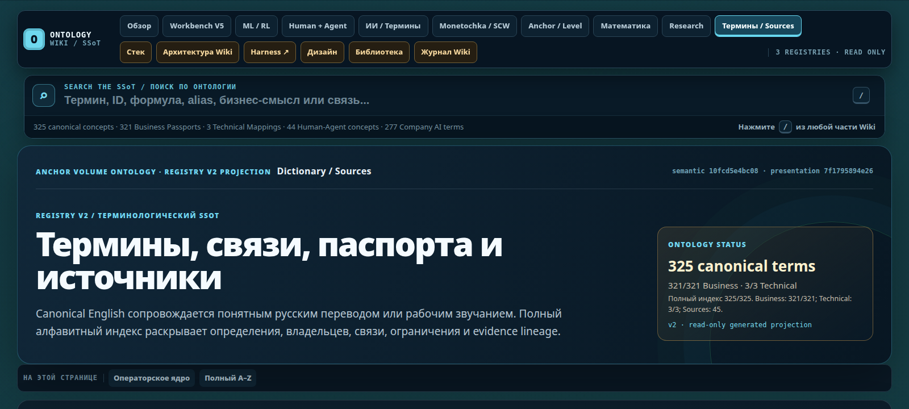

# MyTwoBrain — рабочее место человека и ИИ

**Диалог, документы, агенты и проверка результата — в одном рабочем контексте.**

MyTwoBrain — собственный проект Фёдора Горбунова: среда для агентной разработки
и ведения длительных задач. В её основе — Codex CLI, серверные инструменты
и интерфейс совместной работы человека с агентами.

Harness здесь означает обвязку исполнения: контекст, роли, инструменты,
историю, проверки и управление действиями агента. Пользователь видит эту работу
в интерфейсе; агент обращается к связанным данным через API и CLI.

[Открыть интерактивное рабочее место](workspace.html) ·
[C1 «Факт → Решение»: применение в строительстве](../fact-to-decision/index.html) ·
[Портфолио](../README.md)

<nav class="guide-index" id="contents" aria-label="Разделы обзора">
<strong>Полная карта MyTwoBrain</strong>
<a href="#workspace">01 · Рабочее место</a>
<a href="#architecture">02 · Связи системы</a>
<a href="#execution">03 · Исполнение и передача</a>
<a href="#knowledge">04 · Wiki, Онтология, Тезаурус</a>
<a href="#memory">05 · Память и опыт</a>
<a href="#quality">06 · AST и Agent-CI</a>
<a href="#runtime">07 · Наблюдение и восстановление</a>
<a href="#stack">08 · Стек и владельцы данных</a>
<a href="#maturity">09 · Готовность и развитие</a>
<a href="#applications">10 · Предметные приложения</a>
</nav>

<h2 id="workspace">01 · Диалог и предмет разговора рядом</h2>

### Одна задача — несколько представлений

Предположим, нужно изменить правило расчёта в рабочем приложении.
Это пример процесса, а не отчёт о конкретном внедрении.

1. **Обсудить изменение.** В диалоге человек объясняет задачу, ограничения
   и ожидаемый результат. Агент уточняет условия и предлагает план.
2. **Сверить основание.** Справа открывается документ с действующим правилом.
   Вопросы и ответы остаются слева: содержание документа можно обсуждать,
   не переключаясь между отдельными окнами.
3. **Найти связанные материалы.** Explorer показывает файлы и предпросмотр.
   Markdown отображается с заголовками и таблицами; документ можно открыть
   рядом с другими материалами задачи.
4. **Организовать исполнение.** В реестре видны агенты, роли и состояния.
   Оркестратор распределяет ограниченные задания и собирает результаты;
   за каждой частью работы сохраняется ответственный.
5. **Проверить изменение.** Агент находит затронутый код, выполняет проверки
   и предъявляет результат. Человек сопоставляет его с исходным требованием.
6. **Завершить или продолжить.** Решение, документы и следующий шаг остаются
   связанными с задачей. После перерыва можно восстановить ход работы.

Главный элемент интерфейса — связь левой и правой частей. В одной находится
диалог, в другой — нужное сейчас представление: документ, план, реестр агентов
или перевод. Открытый материал служит основанием разговора.

### Что доступно в рабочем месте

| Действие | Что видит пользователь |
| --- | --- |
| Вести задачу | Диалог, план, история и закладки на значимых фрагментах |
| Работать с материалами | Explorer, предпросмотр, вкладки документов и читаемый Markdown |
| Проверять понимание | Перевод рядом с исходным материалом и доступ к терминологии |
| Управлять исполнителями | Реестр, роли, группы, состояния и переход в диалог агента |
| Выбирать режим работы | Доступные настройки модели и глубины рассуждения |
| Разбирать результат | Изменённые файлы, отчёты проверок и наблюдение за исполнением |
| Продолжить прерванную работу | Сохранённая история, черновик ввода, план и следующий шаг |
| Объяснить связи | Доска для визуального черновика и переход к документу-основанию |

Интерфейс связан с исходными документами и историей исполнения. Он объединяет
доступ к ним, сохраняя отдельное назначение каждого источника.

### Документ, перевод, закладка и доска

Explorer связывает дерево файлов с предпросмотром. Markdown читается как
документ с заголовками и таблицами; PDF, изображения и HTML открываются в
своих представлениях. Вкладки позволяют удерживать несколько материалов.
Перевод можно сопоставить с оригиналом, сохраняя единое написание терминов.

Поиск возвращает к нужному сообщению. Закладка сохраняет важный фрагмент
и замечание, план — этапы работы. Сохранённый черновик помогает не потерять
ещё не отправленное поручение: наличие текста и факт отправки различаются.

Session Board позволяет набросать связи рядом с разговором. Architecture Focus
ведёт от выбранного компонента к его окружению. Принятое решение затем
оформляется в документе или канонической схеме; временная доска сама по себе
не заменяет утверждённую архитектуру.

### Общая точка наблюдателя: UI и API

Человек читает документ, смотрит состояние задачи и принимает решение в UI.
Агент обращается к тем же объектам через API, CLI и файлы их владельцев.
Связь строится на конкретном источнике и версии: какой документ открыт,
какие изменения проверены, где записан результат.

Это позволяет сравнивать увиденное на экране с машинной проверкой.
Сам интерфейс не делает ответы модели детерминированными: воспроизводимыми
должны быть входные данные, проверки и условия приёмки.

<figure><figcaption>Session Board, август 2026. Цельный исходный кадр доски: диалог в центре, рядом — история, знания, план и проверки. SCW и Model Lab обозначены как приложения. Карта объясняет связи; она не сообщает текущую готовность сервисов. Нажмите для увеличения.</figcaption></figure>

<h2 id="architecture">02 · Как устроен Harness</h2>

<a href="#execution"><b>Человек</b>Цель, ограничения, приёмка</a>
→
<a href="#workspace"><b>Общее рабочее место</b>Диалог · документ · план</a>
→
<a href="#execution"><b>Агентная работа</b>Роли · модели · инструменты</a>
→
<a href="#quality"><b>Проверяемый результат</b>Артефакт · версия · проверки</a>

<a href="#knowledge"><b>Знания → контекст</b>Wiki, понятия и действующие документы</a>
<a href="#memory"><b>Опыт → продолжение</b>История, применимые заметки и следующий шаг</a>
<a href="#runtime"><b>Исполнение → наблюдение</b>Состояния, журналы и причины остановки</a>

[Открыть схему связей Harness](../index.html#system): человек и общая точка
UI/API → агентная работа с контекстом и моделями → инструменты → проверка
→ результат для приёмки. Блоки схемы ведут к описанию или соответствующей
сцене интерактивного макета.

| Часть системы | За что отвечает |
| --- | --- |
| Рабочий интерфейс | Диалог, навигация, материалы задачи и действия пользователя |
| Codex CLI | Цикл работы агента и вызовы доступных инструментов |
| Подключение моделей | Настройка вычислительного маршрута отдельно от интерфейса |
| Роли и оркестрация | Постановка ограниченных заданий, распределение работы и сбор результатов |
| Skills и plugins | Процедуры выполнения задач и подключаемые возможности |
| API и CLI инструментов | Чтение данных, работа с файлами и разрешённые операции |
| Серверная среда | Процессы, сервисы, наблюдение за состоянием и восстановление |

Доступность модели, инструмента и право выполнить действие проверяются
отдельно. Выбор модели в интерфейсе не выдаёт агенту дополнительные полномочия.
Подключение другого провайдера требует совместимой интеграции и проверки.

<h2 id="execution">03 · От задачи до результата: исполнение и передача</h2>

Пакет работы, или **Active Work Package**, нужен там, где существенны границы
изменения, зависимости и передача между участниками. В нём фиксируются цель,
то, чего задача не включает, затрагиваемые файлы, ответственный и критерии
приёмки. Для короткого вопроса такой пакет не требуется.

| Этап | Действие | Что остаётся после него |
| --- | --- | --- |
| Постановка | Объяснить требуемое изменение и ограничения | Цель и критерии приёмки |
| Обследование | Прочитать правило, связанные решения и нужную часть кода | Источники и список неизвестного |
| Планирование | Выделить зависимости и способ проверки | Ограниченный пакет работы |
| Исполнение | Изменить код или документ разрешёнными инструментами | Версия артефакта и история изменений |
| Проверка | Выполнить тесты и пользовательский сценарий | Отчёт для конкретной версии |
| Поставка | Опубликовать разрешённое изменение и проверить доступный результат | Рабочая ссылка и подтверждение доставки |
| Приёмка | Сопоставить результат с исходной задачей | Решение человека или замечания |
| Продолжение | Сохранить решения и незакрытые вопросы | Следующий шаг и применимый опыт |

**Квитанция результата (receipt)** связывает действие с его входами,
выходами и проверками. «Планировалось», «выполнено», «не изменено», «не удалось»
и «неизвестно» различаются. Потерянный ответ инструмента не доказывает,
что действие не произошло: перед повтором нужно выяснить фактическое состояние.

### Роли и оркестрация

Именованный агент ведёт свою длительную работу. Временный субагент получает
ограниченное задание и возвращает результат основному исполнителю.
Оркестратор отвечает за согласование частей и общий итог.

Результаты передаются через mailbox — адресные сообщения между участниками.
Уведомление о новом результате помогает вернуться к работе;
принимать результат должен назначенный ответственный.

Независимые изменения готовятся в изолированных рабочих копиях. Перед записью
в общий сервис или публикацией проверяются текущая база и изменения других
участников. Разные файлы ещё не означают независимые сервисы. За объединённый
и проверенный результат остаётся один ответственный.

В проекте предусмотрены PRO-led и CLI-led способы ведения работы: общий план
может удерживать web-агент или назначенный CLI-оркестратор. При передаче
сохраняются та же задача, критерии, права и незавершённые операции. Доступный
канал связи сам по себе не означает полностью автономное управление командой.

### Настройки, инструменты и границы действий

Профиль агента задаёт роль и доступный способ работы. Skills описывают
повторяемые процедуры; плагины и инструменты дают конкретные возможности.
Маршрут модели выбирается отдельно от полномочий: более сильная модель
не получает автоматически право отправить письмо, изменить сервис или
опубликовать результат.

Секреты и частные материалы не входят в публичную витрину. Изоляция данных,
подключение внешнего провайдера и права инструментов требуют отдельной
проверки для каждого внедрения. Наличие этих правил само по себе не является
доказательством полной технической изоляции.

Codex CLI выполняет агентный цикл, а маршрут к модели настраивается отдельно.
В используемой архитектуре CLIProxyAPI связывает исполнение с выбранным
провайдером; сам proxy не является моделью или памятью. Для локального inference
нужна совместимая интеграция и проверка, а не только новая запись в списке моделей.

| Механизм | Назначение | Пример |
| --- | --- | --- |
| Skill | Процедура: когда применять, что прочитать, как проверить | Редакторский QA или проверка браузера |
| Plugin | Упаковка возможностей и инструкций | Подключение работы с документами |
| CLI / API / MCP | Вызов конкретной операции | Получить состояние, прочитать файл, выполнить проверку |
| Профиль агента | Назначение и доступный способ работы | Роль, модель, режим участия, связь с сессией |

Целевой подход к секретам: человек вводит значение защищённым способом,
инструмент использует его по назначению, агент получает результат без ключа.
Полнота этого разделения проверяется для каждого приложения. Здесь описано
архитектурное требование, а не достигнутая изоляция всех компонентов проекта.

<h2 id="knowledge">04 · Wiki, Онтология и Тезаурус: общий язык работы</h2>

В длительном проекте мало хранить файлы. Нужно знать, какое объяснение принято,
что означает термин и где находится документ, определяющий правило.
С сентября Wiki выделена в самостоятельную связанную библиотеку. Она развивается
вместе с Harness: новые договорённости проходят проверку и получают владельца.

### Wiki объясняет тему

Wiki — вход в устройство системы, правила работы и накопленные исследования.
Статья объясняет тему человеку и агенту, показывает статус знания и ведёт к
предметным документам. Каталог помогает найти страницу и её владельца.
Подробный контракт остаётся в своём проекте: его не нужно вручную поддерживать
в нескольких энциклопедических пересказах.

<figure><figcaption>Живая Wiki, снимок 12 октября 2026. Видны поиск, отдельный реестр Human-Agent Symbiosis и переходы к связанным областям. Версия и числа на экране относятся к моменту съёмки.</figcaption></figure>

### Онтология связывает понятия

Онтология задаёт устойчивые идентификаторы, определения и направленные связи.
Агент, его сессия, поручение и группа — разные сущности. Их можно связать,
не объявляя синонимами. Для понятия важны происхождение, домен, владелец и то,
с чем его нельзя путать.

Термины совместной работы человека и агента находятся в реестре Human-Agent
Symbiosis. Терминология исследования временных рядов имеет своего владельца.
Так общий язык не смешивает управление агентом с математическими методами.

### Тезаурус помогает найти

Тезаурус — лексический вход: русское или английское название, сокращение,
синоним и привычное пользователю слово ведут к тому же понятию. Это не новая
независимая база определений. Найденный термин раскрывается через Wiki и
отношения Онтологии, затем поиск приводит к владельцу правила.

<figure><figcaption>Раздел терминов, 12 октября 2026. Название и перевод ведут к определению, связям и источникам. На кадре предметный реестр показан как пример устройства поиска, отдельно от реестра Harness.</figcaption></figure>

<b>Название или синоним</b><small>Тезаурус</small><i aria-hidden="true">→</i>
<b>Объяснение и связи</b><small>Wiki + Онтология</small><i aria-hidden="true">→</i>
<b>Действующий источник</b><small>Контракт · код · реестр</small><i aria-hidden="true">→</i>
<b>Проверка применения</b><small>Тест · результат · версия</small>

**Пример — слово «готово».** Ответ модели завершён; файл создан; тест прошёл;
изменение опубликовано; человек принял результат. Это пять разных фактов.
Общее определение помогает не подменить один другим ни в диалоге,
ни в машинном отчёте.

### Как знания обновляются

Наблюдение получает источник и домен. Проверяются существующее понятие,
дубликаты и противоречия. Устойчивое решение вносится владельцу; представления
пересобираются из источника. Непроверенная находка остаётся кандидатом,
заменённое правило сохраняет связь со своим преемником.

**Librarian — библиотекарь** помогает искать действующий документ, его связи,
историю и пробелы. **DOC Graph** связывает документы, понятия и участки кода.
Граф ускоряет переход к основанию вывода; прав менять смысл у него нет.

<h2 id="memory">05 · Память: история, текущая задача и применимый опыт</h2>

Долгая задача требует больше контекста, чем помещается в очередной запрос
к модели. В MyTwoBrain история, принятые знания и поисковые представления
разделены по назначению.

| Слой | На какой вопрос отвечает |
| --- | --- |
| История диалога | Что обсуждали и какие действия выполняли? |
| План и состояние задачи | Что уже сделано и какой следующий шаг? |
| Wiki и Ontology | Что означает термин, какие договорённости действуют и где их источник? |
| Тезаурус | Как найти то же понятие по другому названию, сокращению или языку? |
| DOC Graph | Какие документы, понятия и участки кода связаны? |
| Zettelkasten | Какие идеи и наблюдения из прошлого могут пригодиться? |
| GoalMemory | Как собрать применимый контекст для продолжения текущей задачи? |

**Zettelkasten** связывает короткие заметки, идеи и паттерны с их источниками.
Нужны условия: где наблюдение работает, что ему противоречит и когда его
перепроверить. Найденная карточка — кандидат на полезный опыт; обнаружение
в поиске само по себе не делает её принятым знанием.

**GoalMemory / situation** собирает ориентацию под текущую задачу: цель,
ограничения, решения, противоречия, доказательства и следующий шаг. Подбор
временный; авторские документы и история остаются у своих владельцев.
Контекст модели помогает текущему рассуждению, но не заменяет проектную память.

Рабочий цикл опыта: **событие → заметка с источником → проверка применимости
→ принятие, отклонение или замена → обновление у владельца**. Это способ
сохранить полезные уроки без бесконечного копирования диалогов.

Документы и код сохраняют своих владельцев. Поисковые индексы и графы ведут
к источнику; заметка из прошлого проходит проверку применимости перед
использованием. Новое наблюдение не становится принятым правилом автоматически.

<h2 id="quality">06 · AST, Agent-CI и проверка результата</h2>

**AST-навигация** показывает структуру кода: символы, импорты и связи.
Она помогает определить, где реализовано правило и что может затронуть правка.
После этого нужны самостоятельные проверки кода и поведения приложения.

**Agent-CI** связывает выбранную версию изменений с набором проверок:
что запускалось, что прошло, где произошла ошибка. Результат проверки относится
к конкретному состоянию исходников; после изменения кода его актуальность
нужно подтвердить заново.

Проверки решают разные задачи:

- тесты проверяют заданное поведение;
- сборка и статический анализ проверяют технические ограничения;
- API и браузерная проверка показывают работу доступного приложения;
- человек оценивает соответствие задаче и удобство результата.

Успешный тест не означает, что изменение уже опубликовано.
Опубликованный интерфейс ещё требует проверки пользовательского сценария.
Окончательное решение о приёмке остаётся у человека.

<h2 id="runtime">07 · Наблюдение за исполнением и восстановление</h2>

Браузер показывает работу агента, но агентный процесс выполняется на сервере.
Отсоединение браузера, ожидание оператора и остановка процесса — разные события.
Сохранённая история позволяет восстановить разговор; состояние незавершённой
операции требует отдельной проверки.

Наблюдение объединяет состояния сессий, сервисов, логи, метрики и трассировки.
Prometheus, Loki, Tempo, Alloy и Grafana выполняют свои роли в диагностике.
Общая операторская поверхность ведёт к подробным данным владельца проблемы.

| Наблюдение | Что важно выяснить |
| --- | --- |
| Агент выполняет действие | Какой процесс и с какой задачей связан? |
| Ожидается решение человека | Что требуется и почему работа остановилась? |
| Источники состояния расходятся | Какой факт свежий, какая часть остаётся неизвестной? |
| Ответ инструмента потерян | Завершилась ли операция до обрыва связи? |
| Результат есть, проверка устарела | Какая версия была проверена и что изменилось? |

Watchdog предназначен для определённого класса сбоев или доставки сигналов.
Его наличие не означает универсальное самовосстановление. Продолжение после
сбоя начинается с текущих файлов, операций и подтверждений, чтобы не повторить
внешнее действие вслепую и не потерять незавершённую работу.

<h2 id="stack">08 · Инженерный стек и владельцы данных</h2>

Архитектура опирается на инженерные средства, которые удерживают процессы,
данные и историю независимо от очередного ответа модели.

| Слой | Средства | Ответственность |
| --- | --- | --- |
| Доступ | Linux, Tailscale, SSH, удалённый рабочий стол | Подключение человека и инструментов к серверу |
| Исполнение | Zellij, Codex CLI, OZ | Терминальная сессия, агентный цикл, запуск и продолжение |
| Сервисы | systemd, Docker | Процессы, зависимости и управляемый жизненный цикл |
| Приложения | Python, JavaScript/TypeScript, веб-интерфейсы | Данные, API, автоматизация и отображение |
| История и артефакты | Git, Markdown, JSON/JSONL, файловая система | Авторские версии, документы и результаты |
| Индексы | SQLite, графы и поисковые представления | Производные маршруты к исходным данным |
| Наблюдаемость | Метрики, журналы, трассировки | Диагностические свидетельства исполнения |

Правило **SSoT — единственного источника истины** применяется к каждому объекту.
Это не одна огромная база на всё. Диалог принадлежит истории сессии, термин —
своему реестру, контракт — документу, код — исходникам, состояние процесса —
его runtime. UI и граф связывают эти источники.

Проекции должны пересобираться. Архив нужен для восстановления и истории;
временный каталог — для ограниченной работы. Завершение задачи включает
сохранение результата и освобождение принадлежащих ей временных ресурсов.
Возраст файла или размер каталога не определяют право удалить данные.

<h2 id="maturity">09 · Готовность и развитие</h2>

Описание обновлено 12 октября 2026 года по текущим документам проекта.
Снимки сопровождаются собственной датой: они показывают устройство интерфейса,
а не гарантируют сегодняшнее состояние всех сервисов.

В проекте используются диалог с историей, документы с предпросмотром,
перевод, реестр агентов, планы, закладки и инструменты проверки изменений.
Wiki, графы документов, Zettelkasten и AST дают разные способы найти контекст.

Оркестрация развивается как управляемая работа человека и агентов.
Назначение команды и принятие общего результата требуют участия ответственного.
Доска, представления контекста и фокуса используются для экспериментов;
полностью автоматическое управление всеми задачами не заявляется.

Работа над восстановлением после сбоев продолжается. Возможность вернуться
к истории не равна гарантии автоматического восстановления каждого процесса.

**«Симбиотическое Я»** — направление развития MyTwoBrain: человек удерживает
смысл и ответственность, агенты помогают выполнять работу, а общая среда
сохраняет контекст и позволяет проверить результат. Это ориентир развития,
не название уже достигнутой безошибочной автономности.

<h2 id="applications">10 · Предметные приложения: результат работы</h2>

Harness организует работу, а приложения решают свои задачи. Они используют
общие возможности контекста, инструментов и проверки, сохраняя собственные
данные и правила.

| Пример | Какая часть опыта полезна для Harness |
| --- | --- |
| [Поток данных / SCW](../examples/data-pipeline.html) | Наблюдение за поступлением данных, полнотой истории и восстановлением |
| [Аналитика и ML-исследования](../examples/analytics.html) | Версии выборок, эксперимент, оценка результата и границы вывода |
| [DORI, прототип подбора камер](../examples/dori.html) | Параметры оборудования, расчёт и визуализация геометрии установки |
| [HR-помощник](https://consulfedor.github.io/candidate-handoff-card/) | Вакансия, интервью и карточка для решения рекрутера |
| [Ферма невидимых кроликов](https://consulfedor.github.io/invisible-rabbit-farm/) | Объяснимая оценка по косвенным наблюдениям |

[Попробовать оригинальный DORI](../examples/dori.html) — исходные
параметры камеры рядом с геометрическими видами и численным результатом.

### Что показывает data/ML-опыт

В работе с временными рядами проверяются пропуски, дубли, границы выборки
и происхождение данных. Горячий поток, канонический ряд, ML-ready представление
и Parquet для эксперимента выполняют разные задачи. Model Lab связывает
конфигурацию обучения, калибровку и тестирование с наблюдаемым результатом.
Этот опыт переносится в Harness как дисциплина проверки входов и воспроизводимости;
он не является обещанием торгового дохода или универсальной точности прогноза.

В DORI виден другой масштаб задачи: параметры установки превращаются в расчёт
и геометрическое изображение. Direct Calculator идёт от камеры к результату,
Designer — от задачи к требованиям оборудования. Предметная модель остаётся
проверяемой пользователем, а итог имеет форму самостоятельного HTML-инструмента.

Эти примеры не означают готовое внедрение в компании заказчика или доказанную
коммерческую эффективность. Основной продукт здесь — MyTwoBrain; C1 показывает
отдельную концепцию применения накопленного опыта в строительстве.

## Что показывает этот проект

MyTwoBrain объединяет практику Фёдора в проектировании агентных процессов,
интерфейсов, контекста и инженерных проверок. Предмет демонстрации — способ
организовать совместную работу: от постановки задачи до проверяемого результата.

В [C1 «Факт → Решение»](../fact-to-decision/index.html) этот подход перенесён
в строительную тематику: документы, чертежи, объёмы, сроки и решения человека.
C1 — концепция внедрения, MyTwoBrain — собственная рабочая среда разработки.

## English abstract

MyTwoBrain is Fedor Gorbunov's human–agent engineering workspace, built around
Codex CLI. It connects conversation, document preview, task history, agent
roles, tools and change validation. Wiki, document graphs, Zettelkasten and AST
navigation provide distinct routes to relevant knowledge and source code.
Agent-CI records checks for a specific code candidate; deployment and human
acceptance remain separate steps. The public workspace illustrates the UI
with demonstration data.
Multi-agent coordination remains human-supervised. Domain applications are
supporting case studies, not substitutes for the Harness itself.

<dialog class="screen-dialog" aria-label="Просмотр экрана крупно"><button type="button" data-close-zoom aria-label="Закрыть увеличенный экран">Закрыть ×</button></dialog>

